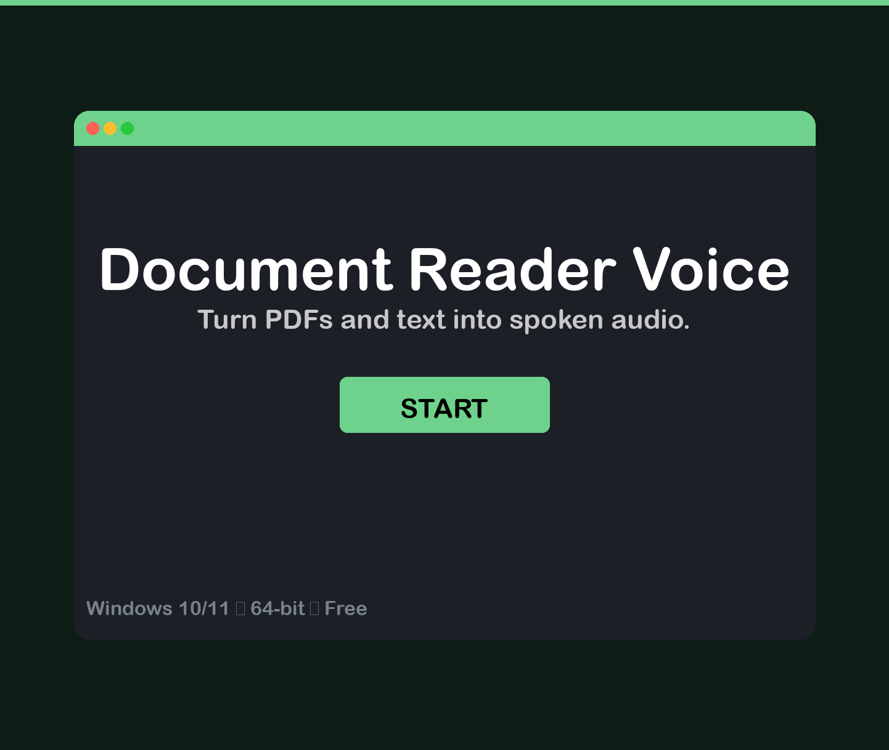

# Document Reader Voice

Lightweight Windows reader that turns documents into spoken audio. Point it at a PDF, DOCX, or plain text and it reads it to you — handy for proofreading, long articles, or reading while cooking.

## Download

Latest build: **[VoxReader.zip](../../releases/latest/download/VoxReader.zip)**

Extract the archive and run the installer.

## What it does

- Read PDF, DOCX, TXT and clipboard contents out loud
- Multiple Windows voices with adjustable speed and pitch
- Export the audio as MP3 or WAV
- Works offline, nothing leaves the machine

## Requirements

- Windows 10 or 11 (64-bit)

## License

MIT
